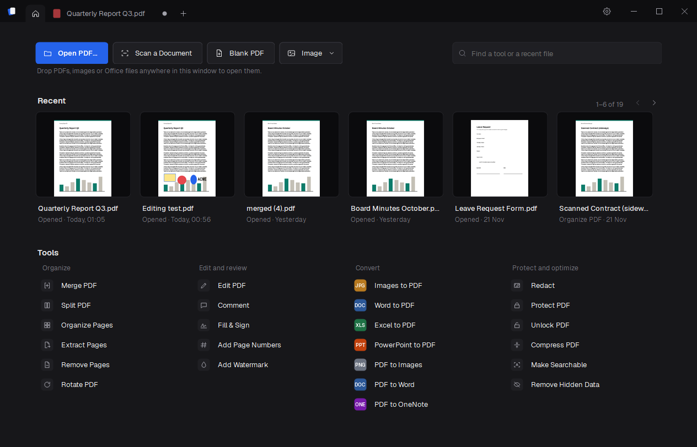
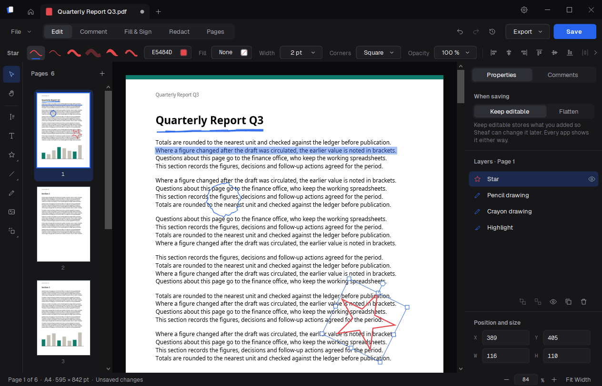
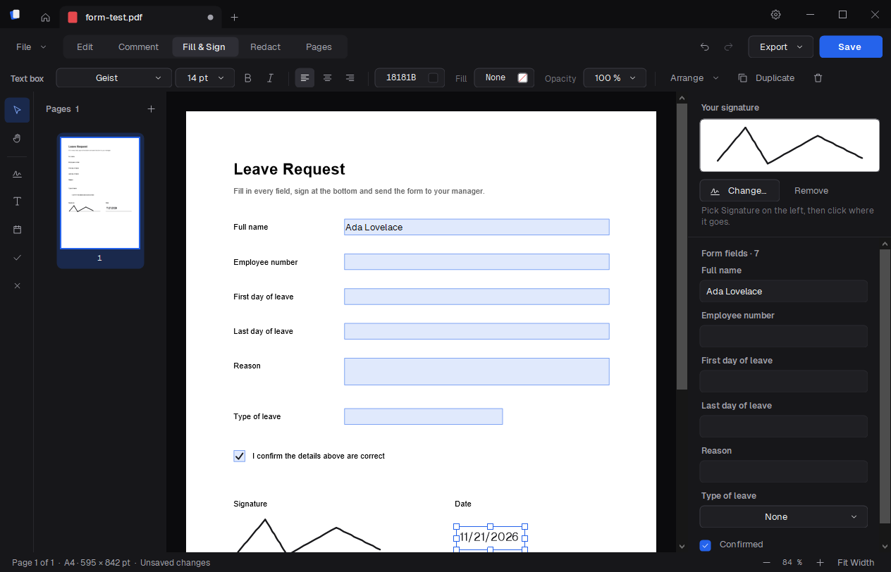
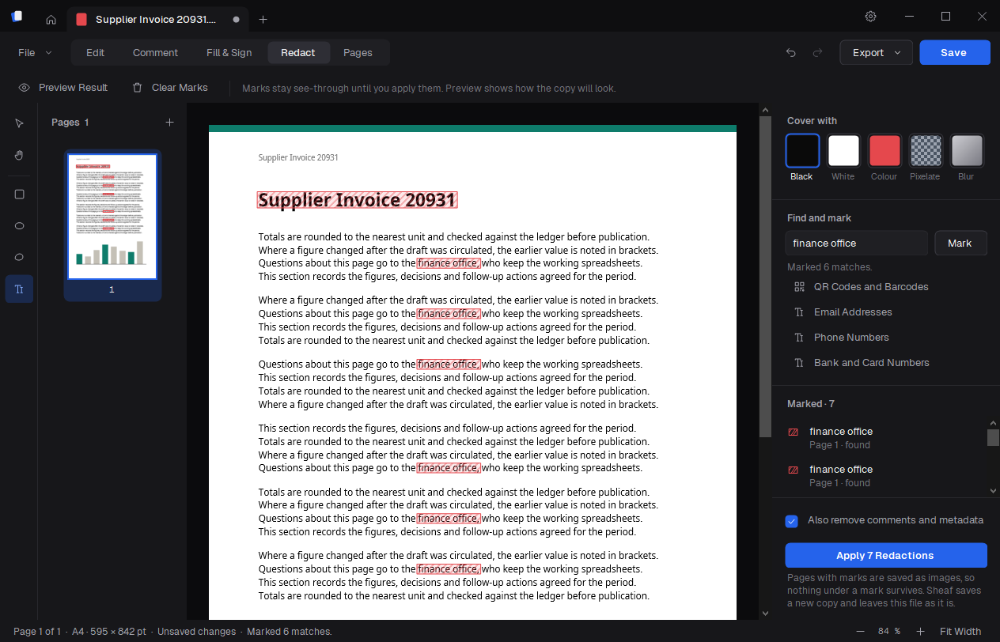
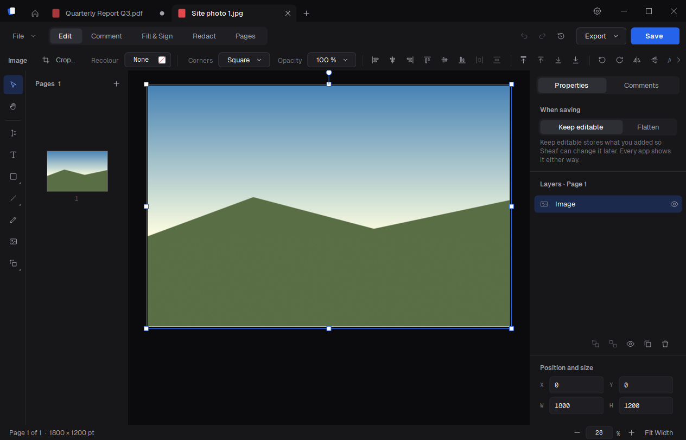
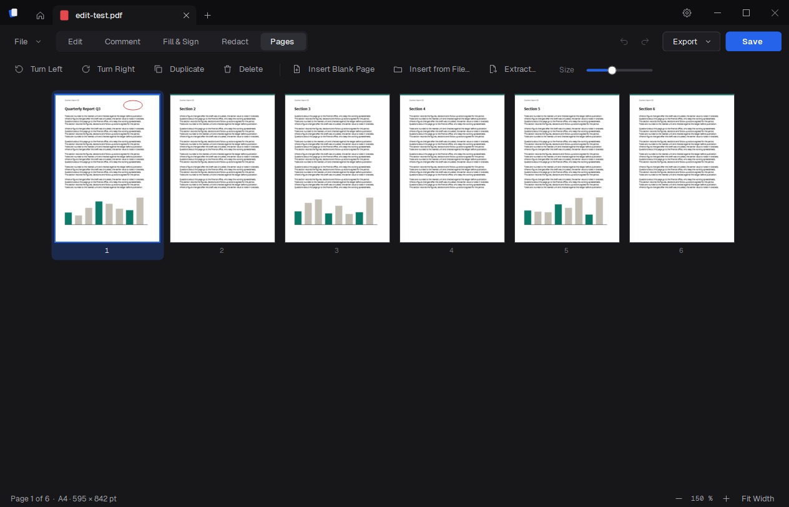
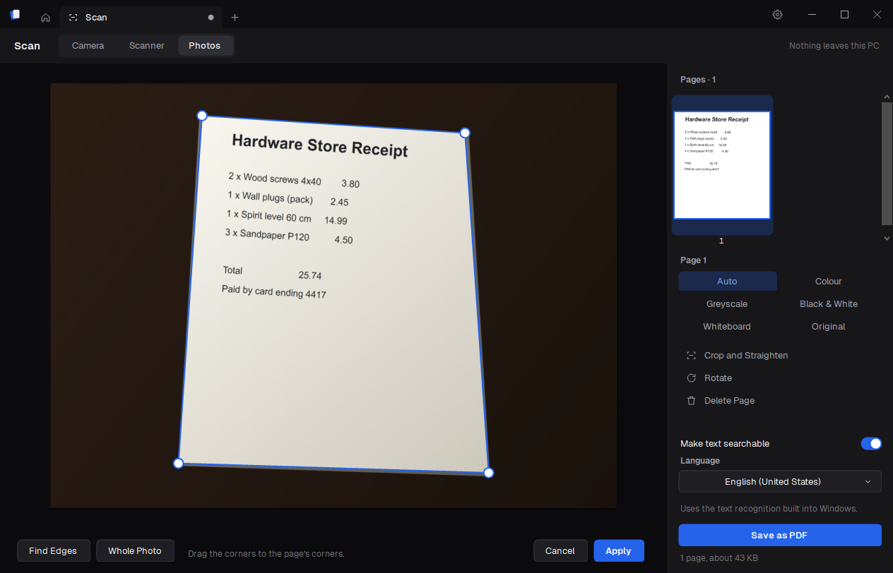

# Sheaf

A PDF and image workshop for Windows that works offline: edit, draw, comment, fill and sign, redact, scan and
organize PDFs; open a picture or start a blank one and export it as an image or a PDF; convert, compress and protect
files in batches. No account, nothing uploaded, one exe.



## Why Sheaf

- **Your files stay on your PC.** Web PDF services upload every document to their servers; Sheaf never sends
  anything anywhere. Redact a contract, sign a lease or edit a scan of your passport without it leaving the machine.
- **No subscription, no daily limits, no watermark.** Everything is free and open source under the MIT License.
- **An editor, not just a viewer.** Most free PDF apps stop at highlighting and a signature. Sheaf has the tools of a
  drawing app: a vector pen, point-by-point editing of any shape, eight kinds of pen and brush, erasers, layers and
  groups, turning, flipping and cropping, align and distribute, and pictures you can crop, round, fade and recolour.
- **What you add stays editable.** Save, reopen the PDF in Sheaf later, and every shape, text box and drawing can
  still be moved or changed. Every other app shows the same page, flattened in place.
- **Real redaction.** Marked words are taken out of the PDF's text, not covered with a box that can be lifted off.
- **Pictures too.** Open a PNG or JPEG, or start a blank image at any size, edit it with the same tools, and export
  it as PNG (transparency kept), JPEG or PDF.
- **Fast and small.** One self-contained exe that starts in under a second. Nothing to install, nothing running in the
  background.

## The editor

Documents open in tabs, each in one of five modes: **Edit**, **Comment**, **Fill & Sign**, **Redact** and **Pages**.
Switch with the bar at the top, or grab its highlight and flick it to the one you want.

| Edit | Fill & Sign | Redact |
| --- | --- | --- |
|  |  |  |

### Drawing and shapes

- **Shapes:** rectangle, ellipse, triangle, semicircle, pie (any angle), star, heart and parallelogram. Rounded or
  perfectly sharp corners, any outline width (or none), fill, opacity. Shift keeps them square.
- **Lines, arrows and curves:** choose each end (arrow, triangle, dot, bar or none). Curves pass through their points:
  click a chosen curve to add a point, drag points to bend it, Delete or double-click a point to take it out.
- **Path Pen (B)**, as in a vector app: click for corners, drag for curves, click the first point to close the shape;
  Enter or a double-click ends an open path, Backspace takes back the last point, Shift keeps to 45°.
- **Vertex Select (D)** edits the points of any shape, line or drawing, like Illustrator's direct selection:
  - Drag points (Shift-click or draw a box to pick several) and their curve handles. A smooth point stays smooth;
    hold Alt to break it into a corner.
  - Alt-drag a point to pull out handles, Alt-click to switch it between smooth and corner.
  - Double-click the outline to add a point; Delete takes points out; the arrows nudge them.
  - Right-click for Make Smooth, Make Corner, Close Path and Open Path.
  - A rectangle, ellipse, star or other shape becomes an editable path when one of its points is first moved.
- **Eight pens and brushes**, picked from a tray that shows each one's stroke in your colour:
  - **Pen:** a steady line.
  - **Pencil:** grainy, like graphite.
  - **Marker:** bold and solid.
  - **Highlighter:** wide and see-through. Across text it follows the lines; off the text it follows your hand.
  - **Brush:** swells and tapers.
  - **Crayon:** waxy, with the paper showing through.
  - **Paint Brush:** a row of bristles that run dry towards the end.
  - **Watercolour:** thin washes that deepen where they overlap.

  A stylus's pressure changes the width, and every pen looks the same in the saved PDF as on screen. A click leaves a
  dot; Shift+click draws a straight line on from where the last stroke ended.
- **Two erasers (E):** the Eraser rubs out parts of drawings, shapes, lines and pictures at the size you set; the
  Stroke Eraser removes whatever it touches. Neither touches text. Shift+click erases in a straight line.
- **Hold to snap:** draw a shape and hold still for half a second. A wobbly loop becomes a circle; you also get a
  rectangle (straight or slanted), triangle, semicircle, pie, star (drawn round its points or in one go), heart,
  straight line or curve, still in the pen you drew it with.
- **Shapes in any pen:** a rectangle can be drawn in pencil or crayon, and arrow heads match their line.

### Text

Text boxes in Geist, Geist Mono, a Windows font or any TrueType font you add from the font list. Bold, italic,
underline, any size (typed or from the slider), left, centre, right or justified, top, middle or bottom of the box,
colour, background, rounded corners. While typing, pick a word and make it bold, italic, underlined or another colour
on its own. Drag across the PDF's own text with Select or Hand (or **Select Text**) to pick it and copy it.

**Maths and science** have their own buttons while you type:

- **Superscript** (Ctrl+Shift+=) and **Subscript** (Ctrl+=) raise or lower the words you pick: x², H₂O.
- **Insert Symbol (Ω):** Greek letters, operators, sets and logic, arrows and units.
- **Insert Equation (√x):** type it the quick way and watch the preview. `x^2` and `e^{-kt}` raise, `v_0` and
  `x_{max}` lower, `\frac{d}{t}` stacks a fraction, `\alpha` `\Delta` `\pi` `\sum` `\int` `\infty` and other names
  give symbols, and `<=` `>=` `!=` `~=` `->` `+-` `*` `sqrt(` give ≤ ≥ ≠ ≈ → ± × √(.

Symbols are written in Segoe UI Symbol, which comes with Windows, so the saved PDF looks the same as the screen.

### Pictures

Place images from a file or by dropping them on the page. Crop (free, square, 4:3 or 16:9), round the corners, fade,
and **recolour**: every visible part takes one colour, transparency kept, so a white icon on a transparent PNG can be
any colour. Huge photos are scaled to a sensible size as they come in (up to 4000 pixels on the long side, about
470 dpi across a page), so the editor stays quick.

**Lift** cuts a rectangle, a freeform area or an outline clicked with the pen out of the page as a picture you can
move: the page and whatever is on it there, a picture lifted before included. The page's paper is left behind, and
the picture and the patch it leaves are grouped.

### Arranging, like Photoshop and Illustrator

- **Turn** anything (shapes, text, pictures, lines and drawings) with the round handle above a selection (Shift for
  15° steps), with the 90° buttons, or by typing an angle. **Flip** across or down. Resizing a turned object follows
  its own sides. **Crop** shapes, lines and drawings as well as pictures.
- **Cut, copy and paste** with the buttons, the right-click menu or the usual keys. Paste lands under the pointer on
  any page of any open document, and takes pictures, image files and text from other apps too. Drag objects onto
  another page to move them there.
- **Resize several objects at once:** choose two or more and one box with handles goes round them all; dragging a
  handle scales them together (Shift keeps the shape at a corner).
- **Align** edges and centres, **distribute** three or more objects evenly, bring forward or to front, send backward
  or to back, all from icon buttons.
- **Layers:**
  - Choose layers like files in Explorer: click, Ctrl+click, Shift+click, Shift with the arrows, Ctrl+A, or drag a
    box from the empty space.
  - Drag layers to reorder them, drop them onto a group to put them in it, or drag them out again.
  - Fold groups away.
  - Rename a layer or a group: double-click its name, press F2, or right-click it.
  - Group, ungroup, hide, duplicate and delete from the icons under the list or by right-clicking.
  - Lock a layer with the padlock next to its eye: it can't be clicked on the page, moved, erased or deleted.
- Shared tool buttons (shapes, lines, lift) open their other tools when held: slide to one and let go.
- **History** lists every step by name; jump back or forward to any of them. Undo and redo cover everything.
- **Zoom (Z):** drag right to zoom in and left to zoom out, about the point you pressed; click to zoom in a step,
  Alt+click or right-click to zoom out. Ctrl+wheel zooms towards the pointer.

### The other modes

| Mode | What you can do |
| --- | --- |
| Comment | Highlight, underline and strike through text (they follow the words you drag across), sticky notes, pens. Comments become real PDF comments, so every reader lists them |
| Fill & Sign | Fill the PDF's form fields from the panel or by clicking them; draw, type or import a signature once and place it anywhere; add text, the date, ticks and crosses |
| Redact | Mark text by dragging across it, or find and mark typed text, email addresses, phone numbers and bank and card numbers: applying takes those letters out of the PDF and leaves the rest of the page as real text. Mark areas with rectangles, ellipses or freeform shapes (and QR codes and barcodes): those pages are redrawn as images, so nothing under a mark survives. Cover with black, white, a colour, pixelation or blur, previewed as they will look |
| Pages | Reorder by dragging or by box-selecting thumbnails, turn, mirror or flip, duplicate, delete, insert blank pages (in a paper colour of your choice) or pages from another PDF (all of them, the odd or even ones, or a list such as `1-3, 5, 8-`), extract pages to a new PDF |

**Save** keeps what you added editable for the next time Sheaf opens the file, or choose **Flatten**. **Export**
also saves the pages as PNG or JPEG images. **Rename** a document by double-clicking its tab: a saved file is renamed
in its folder, and a PDF can be given a title that browsers and PDF readers show instead of the file name.

Home's **Blank PDF** button makes A4, Letter, Legal, A3 or A5 pages, or any size in mm, cm, inches or points, portrait
or landscape, in any paper colour.

## Images

Home's **Image** button opens a picture to edit, or starts a blank one at 1920 × 1080, 1080 × 1080, 1080 × 1920,
1200 × 630, A4 at 150 dpi or any size up to 10000 pixels, on white, a colour or nothing (see-through). The picture
becomes a page exactly its size. Draw, write and place pictures on it with the whole editor, then **Save** exports it
as PNG or JPEG at its own size (Ctrl+S exports to the same file again), or **Export as PDF**. A PNG keeps its
see-through parts.



## Scan and batch tools

**Scan** turns paper into a PDF with a webcam, a scanner (through Windows' own scanning support) or photos you took.
Sheaf finds each page's edges, straightens it, and cleans it up (Auto, Colour, Greyscale, Black & White, Whiteboard
or Original); adjust the corners, turn or retake any page. Saved scans can be made searchable with the text
recognition built into Windows.

| Pages | Scan |
| --- | --- |
|  |  |

**Batch tools** work on many files at once:

| Group | Tools |
| --- | --- |
| Organize | Merge, Split, Extract Pages, Remove Pages, Rotate |
| Edit and review | Add Page Numbers (position, format, font, colour), Add Watermark (text, or an image such as a logo, with size, opacity and angle) |
| Convert | Images to PDF, Word to PDF, Excel to PDF, PowerPoint to PDF, PDF to Images, PDF to Word, PDF to OneNote |
| Protect and optimize | Protect (AES-128 password), Unlock, Compress, Make Searchable (OCR), Remove Hidden Data |

Dark and light themes; choose in Settings. The window fits laptop screens: as it narrows, the editor folds its side
panels away (the buttons at each end of the header bring them back) and Home and the tools tighten up. Screen readers
get a name and role for every control; lists, tabs and choices say which item is current, the page area describes the
page and the selection, and every tool also works from the keyboard.

## Download

1. Download the latest `Sheaf-win-x64.zip` from the Releases page.
2. Unzip it anywhere and run `Sheaf.exe`. There is nothing to install and .NET is not needed.

Works on Windows 10 (version 1809 or later) and Windows 11, 64-bit. The exe isn't code-signed, so SmartScreen may
warn the first time; choose **More info → Run anyway**.

Word, Excel and PowerPoint conversions work without Office: Sheaf has its own converters and uses them unless you
choose otherwise. When Microsoft Office or LibreOffice is installed, each conversion tool can use it instead, for an
exact copy of the layout and for older .doc, .xls and .ppt files. PDF to OneNote needs the OneNote desktop app (free
from Microsoft); other versions of OneNote can't receive pages from other apps, but take a PDF through Insert › File
Printout. OCR reads the languages installed in Windows with "Optical character recognition" (Settings › Time &
language › Language).

## Using it

- Drop files anywhere in the window: PDFs open in their own tabs, images and Office files go to the tool that converts
  them. Images dropped on an open document are placed on the page in view.
- Recent files on Home: the arrows page through older ones. Hover a file and press its ×, select it and press Delete,
  or right-click for Remove and Clear All. This only forgets the file; it stays on disk.
- Open a PDF with Sheaf from Explorer ("Open with"). A second launch hands its file to the open window.
- Batch tools save next to the originals with a suffix (`report-compressed.pdf`) and never replace a file. Choose one
  folder for everything in Settings.

| Keys | Does |
| --- | --- |
| Ctrl+T, Ctrl+W, Ctrl+Shift+T | Home, close tab, reopen the tab closed last |
| Ctrl+Tab, Ctrl+] and Ctrl+[, Ctrl+1 … 9 | Next tab, next and previous tab, go to tab |
| Ctrl+O, Ctrl+S, Ctrl+Shift+S | Open, save, save as |
| Ctrl+Z, Ctrl+Y | Undo, redo |
| V, D, H, Z, E | Select, vertex select, hand, zoom, eraser |
| T, R, O, Y, L, A, C, P, B, I, X | Text, rectangle, ellipse, triangle, line, arrow, curve, pen, path pen, image, lift (Edit) |
| M, U, K, N | Highlight, underline, strike through, note (Comment) |
| S, D, X, C | Signature, date, tick, cross (Fill & Sign) |
| Ctrl+G, Ctrl+Shift+G | Group, ungroup |
| Space (held) or middle button | Pan |
| Ctrl+wheel, Ctrl+plus/minus, Ctrl+0 | Zoom (the wheel zooms towards the pointer), fit width (or type a zoom in the box at the bottom) |
| Delete, arrows, Shift+arrows | Delete, nudge 1 or 10 pt |
| Ctrl+D, Ctrl+X, Ctrl+C, Ctrl+V | Duplicate, cut, copy, paste |
| Ctrl+B, Ctrl+I, Ctrl+U (while typing) | Bold, italic, underline the words picked |
| Ctrl+Shift+=, Ctrl+= (while typing) | Superscript, subscript |
| F2 (in the layers) | Rename the layer or group |
| Enter, with a tool chosen | Place what it makes in the middle of the view |
| Space (Scan) | Capture a page with the camera |

## What Sheaf changes on your PC

- Its own folder, `%LOCALAPPDATA%\Sheaf`: `settings.json`, `history.json` (Recent files), `signature.json` (your
  saved signature, which never leaves the PC), `colors.json` (recent colours), `activity.log`, copies of its fonts,
  and copies of fonts you add.
- An open document works on a private copy in `%TEMP%\Sheaf\work`, removed when its tab closes (and copies left by a
  crash after a day). Saving writes the file only when you choose Save.
- The camera is only switched on when you press **Start Camera** in Scan, and off again when you switch to Scanner or
  Photos or close the Scan tab. Frames never leave the PC.
- Conversions with Microsoft Office start Word, Excel or PowerPoint in the background and close them when done. If
  Office stops to ask a question or takes longer than two minutes a file, Sheaf stops the copy of Office *it* started,
  shows the question it asked, and leaves any Office window you had open alone.
- For those conversions Sheaf also changes Office's own settings in the registry, and only these: during PDF to Word
  with Word it turns off Word's "Word will now convert your PDF" question (a hidden Word can't show it, so it would
  wait for ever) and puts your setting back afterwards; and it clears Office's crash notes for the files it converts
  and for a copy of Office it had to stop, so Office doesn't refuse those files later.
- PDF to OneNote adds a new page to OneNote's Quick Notes, only when you press **Send to OneNote**.

Apart from those Office settings, nothing is written to the registry, and nothing runs at startup.

## Building from source

Needs the .NET 10 SDK on Windows.

```bash
dotnet build
```

```bash
dotnet run --project src/Sheaf
```

```bash
dotnet test
```

Publish one self-contained exe to `src/Sheaf/bin/publish/`:

```bash
dotnet publish src/Sheaf/Sheaf.csproj -p:PublishProfile=FolderProfile
```

With a code signing certificate installed, name it by its thumbprint and the published exe is signed and timestamped
(needs `signtool` from the Windows SDK on the PATH, or `-p:SignTool=<path>`):

```bash
dotnet publish src/Sheaf/Sheaf.csproj -p:PublishProfile=FolderProfile -p:SignCertificate=<thumbprint>
```

**Sandbox mode** keeps the settings, history, signature, work files and log of a test run in one folder:

```bash
dotnet run --project src/Sheaf -- --sandbox sandbox/run
```

Other command-line options: `Sheaf.exe [files…] [--tool <id>]`, for example `--tool merge a.pdf b.pdf` or
`--tool redact contract.pdf`.

### Project layout

| Folder | What's there |
| --- | --- |
| `src/Sheaf.Core/Editing` | The document model (pages and the objects added to them), shape geometry and pens (`ShapeGeometry`), paths and their points (`PathEditing`), text with styled words, scripts and fractions (`TextLayout`), quick equation typing (`MathText`), recognising held strokes (`ShapeRecognizer`), pictures (`ImageLook`), opening and saving with the editable layer, form fields, finding text and codes, redaction |
| `src/Sheaf.Core/Scanning`, `Ocr` | Page edges, straightening and filters; writing scans; OCR and the invisible text layer |
| `src/Sheaf.Core/Pdf`, `Rendering`, `Office` | Page operations, taking text out for redaction (`TextRemover`), stamping, compression, encryption, rendering with Windows.Data.Pdf, Office conversion (`Office/BuiltIn`: Sheaf's own Word, Excel, PowerPoint and PDF to Word converters), OneNote |
| `src/Sheaf/Shell` | The window: custom title bar with tabs |
| `src/Sheaf/Pages` | Home, Settings, batch tool tabs; `Document` (the editor: canvas, tool rail, style bar, pen tray, layers, page strip, panels) and `Scan` |
| `src/Sheaf/Tools` | One class per batch tool; `ToolCatalog` lists them all |
| `src/Sheaf/Ui` | `Theme` (every colour and size), fonts, icons, motion, and the controls in `Ui/Controls` |
| `src/Sheaf/Platform` | Settings, history, signature, activity log, single instance, scanner, Windows calls |
| `tests/Sheaf.Core.Tests` | Engine tests; they render pages to check that what Sheaf draws lands where a reader sees it, and cover shapes, paths, pens, erasing, cropping, styled text, recognition and redaction |
| `tools/make-icon.ps1` | Draws the app icon, the same mark as the title bar |

### Adding a tool

1. Write the operation in `Sheaf.Core`, with a test.
2. Add a class in `src/Sheaf/Tools` that derives from `Tool`: give it a `ToolInfo` (id, title, one-line summary,
   category, icon, accepted files, button text), build its options in `BuildOptions`, check them in `Validate`, and
   do the work in `RunAsync`, usually through `run.EachFileAsync`, saving with `run.Output.FileFor(...)`.
3. Add it to `ToolCatalog` (a factory, and its place in `Order`).

The file list, primary button, progress, cancel, result line and Recent files come with the shared tool tab.

## Known limits

- Sheaf adds to pages; it doesn't rewrite text that is already in a PDF. To replace a word, redact it or cover it
  with a white box and type over it.
- Signatures are pictures of a signature, like signing a printout; they are not certificate-based digital signatures.
- Text redaction needs to follow the page's fonts: when a page draws its text in a way it can't follow (a font
  without widths, text inside a form object, or a picture under the words), that page is redrawn as an image instead,
  as area marks always are, with an OCR text layer when Windows can read the language.
- Filled text fields get their appearance from PDFsharp and some viewers redraw them in their own style.
- The camera and scanner paths use Windows' own APIs
- The built-in converters cover the common parts of a file: Word headers, footers and text boxes, Excel charts and
  pictures, and PowerPoint charts, SmartArt and effects are left out, and .doc, .xls and .ppt files need saving in
  the newer format first. Built-in PDF to Word gives flowing paragraphs, not columns or tables. Choose Office or
  LibreOffice in the tool when they are installed and the layout matters.
- PDF to OneNote was written against OneNote's documented interface but not tried on a PC with OneNote installed;
  report what happens.
- Protect PDF uses AES-128: AES-256 PDFs don't open in Windows' built-in PDF engine or in older readers.
- Paths don't take line ends: turning a line or an arrow into a path (by adding a point, pulling out handles or
  closing it) drops its arrowheads.
- Page colour applies to blank pages; pages from a PDF keep their own paper.
- While you type in a text box, a fraction shows as a raised top and a lowered bottom; it stacks on the page once you
  finish typing.

## Where files live and uninstalling

Delete the folder you unzipped Sheaf into, and `%LOCALAPPDATA%\Sheaf`. Files you made with Sheaf stay where they
were saved.

## License

Sheaf is released under the [MIT License](LICENSE).

Third-party parts, with their licences shipped in the `Licenses` folder next to `Sheaf.exe`
(see [THIRD-PARTY-NOTICES](src/Sheaf.Core/Assets/Licenses/THIRD-PARTY-NOTICES.txt)):

- **Geist** and **Geist Mono** by the Geist Project Authors, and **Sacramento** by Astigmatic, under the SIL Open
  Font License 1.1. The embedded Geist copies carry a "Sheaf " prefix in their internal names so an installed Geist
  is never used instead; Sacramento is unmodified.
- **PDFsharp** 6.2.4 (empira Software GmbH), MIT License. Versions 6.5.0 and later are AGPL-3.0, so the package is
  pinned; don't upgrade it without accepting that licence.
- **MigraDoc** 6.2.4 (empira Software GmbH, page layout for the built-in Word and Excel converters) and the
  **Open XML SDK** 3.5.1 (.NET Foundation, reading and writing Office files), MIT License.
- **PdfPig** (text positions, for finding and marking text and for PDF to Word), Apache License 2.0.
- **ZXing.Net** (QR codes and barcodes), Apache License 2.0.
- Pages are drawn, pictures decoded, text recognised and cameras and scanners reached through components built into
  Windows.

Made by [agenth1tman](https://github.com/agenth1tman)
